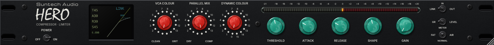

# Suntech Audio HERO

Windows x64 VST3 feedback compressor built from the supplied Titan research v10 engine, with the supplied Suntech Audio HERO rack GUI. This is an independent Titan-inspired software model, not a measured circuit-identical or manufacturer-endorsed emulation.

**Windows x64 Release 0.1.2: verified.** [Download the complete VST3](https://github.com/skimaone/Helioside-HERO/actions/runs/39985144107/artifacts/12514798226) · [Tests and GUI captures](https://github.com/skimaone/Helioside-HERO/actions/runs/39985144107/artifacts/12515556885) · [Build report](docs/RELEASE_0.1.2.md)



## Install

Download the Windows VST3 artifact from a successful [Actions build](https://github.com/skimaone/Helioside-HERO/actions). Extract the artifact and its inner `SuntechAudioHERO-0.1.2-Windows-x64-VST3.zip`. Close FL Studio, copy the complete `Suntech Audio HERO.vst3` folder to `C:\Program Files\Common Files\VST3`, keeping `Contents` intact, then rescan in Plugin Manager. The ZIP includes checksums and a per-file manifest.

## Controls

- Threshold, Attack, Release and Shape retain the draft's 0–99 indices and defaults 45/30/30/45. The threshold reference is −40 to 0 dBFS; nominal attack is 50 µs to 400 ms, release 50 ms to 6 s. These are model mappings, not calibrated hardware measurements.
- VCA Colour and Dynamic Colour have 16 positions, default 0. The red encoders wrap 15→0. Colour is reduction-dependent. Version 0.1.3 references both nonlinear stages to the signal entering the gain cell before applying its shared attenuation, and resolves light GR with smooth activation. This preserves their contrast under compression; numerical strengths remain inferred. Dynamic Colour retains the opposite odd-order curvature and exact inactivity below compression onset. See [colour and sizing notes](docs/RELEASE_0.1.3.md).
- Parallel Mix has 16 positions: 0 is 94% dry / 6% compressed; 15 is fully compressed (default). The dry and wet branches share the oversampled timeline.
- Gain provides 0–11.5 dB make-up in 0.5 dB steps on the compressed branch.
- The IN / OUT front switch engages compression or provides raw bypass delayed by the reported plugin latency. Right-click → Stereo control selects Linked (default) or Independent L/R; OUT → IN restores that selection. POWER off and host bypass follow the same delayed-raw policy. Transitions fade over 20 ms.
- FAT / NORMAL / AIR select the draft's GR-dependent detector/audio voicing; NORMAL is default. The front toggle selects FAT left / NORMAL down / AIR right. Click the corresponding throw or drag towards it; left/right/down arrow keys follow the same positions. Right-click → Tone also retains all three options.
- GR shows actual modeled attenuation. LEVEL is output peak level relative to the −18 dBFS = 0 VU convention. The meter spans −21 to +20 relative dB. It is not a loudness meter.
- Fresh instances open at 1200×111 logical pixels, smaller than Trakka’s 1440×133. Oversized preferences from older HERO versions are capped at 100% once; smaller legacy sizes and zooms chosen after migration are retained. Original high-resolution artwork and 75–200% zoom remain.
- Right-click the faceplate for stereo control, tone, 4x/8x whole-engine FIR oversampling (4x default), interface zoom and About. Latency stays at 65 host samples; both quality paths remain warm for smooth switching.
- Drag knobs vertically, Shift-drag for fine movement, double-click to reset, or use wheel/arrow keys. Red encoders require 16 logical pixels per detent (64 with Shift), eight times the previous drag distance. Teal knobs require 360 logical pixels across their full range (1440 with Shift). Ordinary wheel notches move one step; smooth wheel input accumulates without jumping. The editor is resizable from 75% to 200% with fixed 1U proportions.

The LCD shows live indices, make-up gain, IN/OUT/LINK, a white clean-cell static feedback knee and an amber timing trajectory. The amber trace uses the existing clean engine to follow a repeatable 500 ms upward / 500 ms downward level sweep, so Attack and Release affect it. Its axes remain input/output level; it is a controlled response preview, not a music scope. The static white curve depends on Threshold and Shape, not attack/release timing. It follows the DSP mapping rather than the GUI pack's separate suggested feed-forward mapping. Both curves omit colour, tone and make-up; detector memory is present in the amber trace. The glass treatment restores the supplied reference's round dot texture, fixed pixel variation, coloured bloom, reflection and vignette.

HERO is a compressor with colour and make-up gain; it does not impose a final digital brickwall/true-peak ceiling. Use output headroom appropriate to the next stage.

## Build

JUCE 8.0.4 is pinned from the official JUCE repository; alternatively supply `-DJUCE_DIR=/path/to/JUCE`. Windows CI uses `windows-2022`, MSVC x64 Release and static runtime. No global fast-math is enabled.

```powershell
cmake -S . -B build -G "Visual Studio 17 2022" -A x64 -DBUILD_TESTING=ON
cmake --build build --config Release --parallel 2
ctest --test-dir build -C Release --output-on-failure
```

For the no-JUCE engine/regression programs only, use `-DHERO_BUILD_PLUGIN=OFF`. Original supplied source/tests/research notes remain under `research/`; GUI source images are embedded, with no runtime file dependencies. Mistral is already baked into the supplied faceplate and is not distributed as a font. The embedded LCD font license and original DSP MIT notice are included in the VST3 bundle.

See [implementation and evidence notes](docs/ENGINEERING.md). Successful Actions runs provide complete VST3 bundles, tests/GUI captures and matching PDB/MAP crash symbols. FL Studio itself is not available on the runner; native VST3 loading, audio and window lifecycle are checked by the test host.
